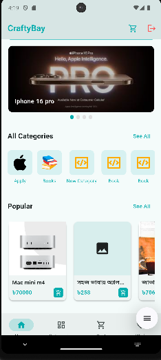
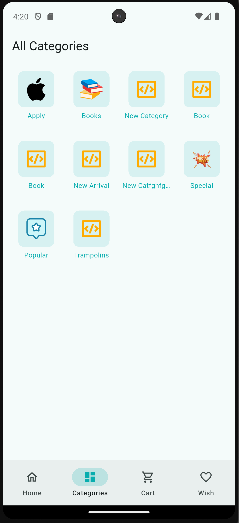
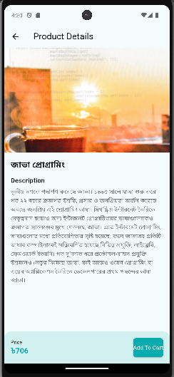
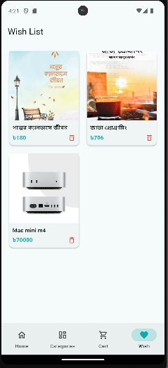
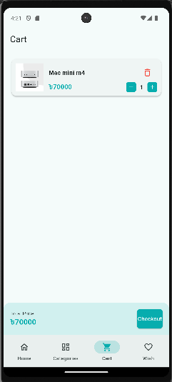
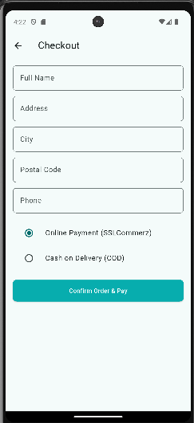

# 🛍️ CraftyBay - Flutter E-Commerce Application

A full-featured, responsive E-Commerce mobile application built with **Flutter**, **GetX**, and **REST API** integration as part of the **Ostad Flutter App Development Course (Module 22 Assignment)**.

---

## ✨ Features

- **Authentication Flow:** Splash Screen, User Login, Sign Up, 4-Digit OTP Verification, Persistent Login (`SharedPreferences`), and Logout.
- **Home Dashboard:** Dynamic Promotional Carousel Slider, Search Bar, Horizontal Categories, and Popular / Special / New Product sections.
- **Categories & Filtering:** Dedicated All Categories Grid and Category-wise Product Listing.
- **Product Details & Reviews:** Full product description, pricing, Add to Cart, Add to Wishlist, and Customer Reviews (View & Submit new ratings/comments).
- **Wishlist Management:** View saved items, add products to wishlist, and remove items in real time.
- **Shopping Cart:** View cart items, increment/decrement quantity (`PATCH`), delete items (`DELETE`), and automatic Total Price calculation.
- **Checkout & Payment:** Shipping address form with validation, **Online Payment (SSLCommerz)** gateway launch via `url_launcher`, and **Cash on Delivery (COD)** support.

---

## 📱 Screenshots

| Login | Home | Categories | Product Details |
| :---: | :---: | :---: | :---: |
|  |  |  |

| Reviews | Wishlist | Cart | Checkout |
| :---: | :---: | :---: | :---: |
|  |  |  |  |

---

## 🛠️ Tech Stack & Packages

- **Framework:** Flutter & Dart
- **State Management & Routing:** `get` (GetX)
- **Networking:** `http` (Custom `NetworkCaller` with token header & error handling)
- **Local Storage:** `shared_preferences`
- **UI & Utilities:** `carousel_slider`, `pin_code_fields`, `url_launcher`
- **Backend API:** `https://ecom-rs8e.onrender.com/api`

---

## 📂 Project Structure

```text
lib/
├── main.dart
├── app/
│   ├── app.dart
│   ├── app_colors.dart
│   ├── controller_binder.dart
│   └── urls.dart
├── core/
│   └── services/
│       ├── auth_controller.dart
│       └── network_caller.dart
└── features/
    ├── auth/
    │   ├── controllers/
    │   └── screens/
    ├── home/
    │   ├── controllers/
    │   ├── models/
    │   └── screens/
    ├── product/
    │   ├── controllers/
    │   └── screens/
    ├── cart/
    │   ├── controllers/
    │   └── screens/
    └── wishlist/
        ├── controllers/
        └── screens/
```

---

## 🚀 Getting Started

1. **Clone the repository:**
   ```bash
   git clone [https://github.com/asickuzzamanmd/crafty_bay_ecommerce.git](https://github.com/asickuzzamanmd/crafty_bay_ecommerce.git)
   cd crafty_bay_ecommerce
   ```

2. **Install dependencies:**
   ```bash
   flutter pub get
   ```

3. **Run the app:**
   ```bash
   flutter run
   ```

### 🔑 Test Credentials
- **Email:** `meskatcse@gmail.com`
- **Password:** `123456`
- **Static OTP (for new signups):** `1234`

---

## 👨‍💻 Author

**Md. Asickuzzaman**  
GitHub: [@asickuzzamanmd](https://github.com/asickuzzamanmd)